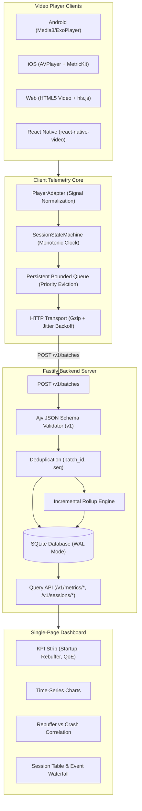
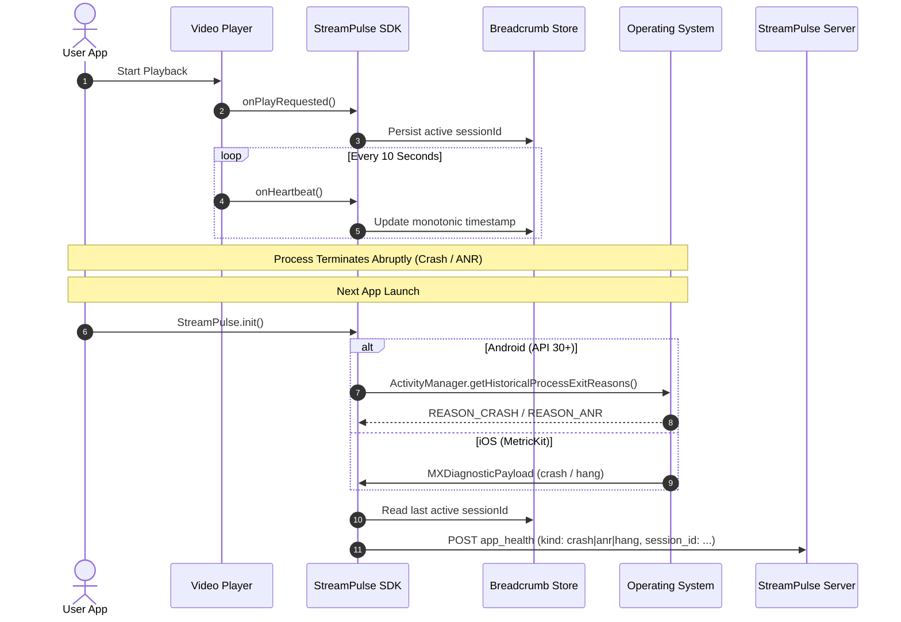

# StreamPulse Architecture & System Design

StreamPulse is an open-source, portfolio-grade video playback quality-of-experience (QoE) telemetry library and performance dashboard. It measures video startup latency, rebuffering episodes, dropped frame ratios, bitrate behavior, playback errors, and correlates fatal crashes/ANRs with active playback sessions.

---

## 1. High-Level System Architecture

---

## 2. Core Architectural Principles

### 2.1 Schema-First Source of Truth
The entire system originates from `spec/event-schema.v1.json`.
- Event payloads, batch envelopes, and metadata are strictly defined in standard JSON Schema Draft 2020-12.
- Codegen scripts (`spec/codegen/generate.py`) automatically generate type definitions for Kotlin Multiplatform (`@Serializable`), Swift (`Codable`), and TypeScript (`models.ts`).
- CI enforces codegen freshness (`make check`). Hand editing generated models is prohibited.

### 2.2 Measurement Rigor: Clocks and Skew Calibration
- **Duration calculations** strictly rely on monotonic clocks (`t_mono_ms`):
  - Android: `SystemClock.elapsedRealtime()`
  - iOS / macOS: `ProcessInfo.processInfo.systemUptime * 1000`
  - Web: `performance.now()`
- **Wall-clock timestamps** (`t_wall`, ISO-8601) are recorded solely for chronological ordering and correlation with backend log aggregation.
- **Clock Skew Compensation**: Every ingest response returns the standard HTTP `Date` header. Client SDK transports measure network round-trip time and calculate relative server clock skew to adjust wall timestamps.

### 2.3 Offline Resilience & Bounded Queueing
Network dropouts and airplane mode must never cause event loss or memory exhaustion:
1. **Persistent Backing**: SQLDelight on Android, SQLite / file store on iOS, and IndexedDB on Web.
2. **Bounds**: Max 5,000 events or 5 MB storage limit.
3. **Priority Eviction**: When capacity is reached, the queue evicts oldest non-critical events first (e.g. `heartbeat`, `buffering_start`). Critical diagnostic events (`app_health` and `playback_end`) are protected with strict eviction immunity.
4. **Resilient Flush**: Flushes are triggered every 20 events, every 15 seconds, upon playback end, on app backgrounding, and on manual `StreamPulse.flush()`. Retries use exponential backoff with jitter (base 2s, cap 5m) honoring HTTP `Retry-After`.

---

## 3. Crash and ANR Correlation

StreamPulse correlates fatal crashes and Application Not Responding (ANR) events with the active playback session without replacing or interfering with host crash reporters (e.g. Sentry, Firebase Crashlytics).

- **Android (API 30+)**: Reads `ApplicationExitInfo` via `ActivityManager.getHistoricalProcessExitReasons()`. For API < 30, chains a delegating `Thread.UncaughtExceptionHandler`.
- **iOS**: Registers as `MXMetricManagerSubscriber` to capture `MXDiagnosticPayload` (`crashDiagnostics`, `hangDiagnostics`).
- **Correlation Boundary**: Android correlation is immediate on the next launch. MetricKit delivers diagnostic payloads asynchronously on Apple's diagnostic schedule (up to 24 hours later). Both map cleanly to the breadcrumb session ID.

---

## 4. Metric Parity & Oracle Verification

All metrics are formally defined and verified across four separate runtimes against shared golden test fixtures (`spec/fixtures/`):
1. **Python Oracle** (`spec/lib/compute.py`)
2. **Fastify Backend** (`server/src/rollup.ts`)
3. **Kotlin Multiplatform Core** (`core/.../MetricFold.kt`)
4. **TypeScript Web SDK** (`web/src/session.ts`)
5. **Swift iOS SDK** (`ios/.../MetricFold.swift`)

Every implementation produces bit-for-bit identical rollups for startup time, rebuffer ratios, dropped frames, time-weighted bitrate, and composite QoE scores.
